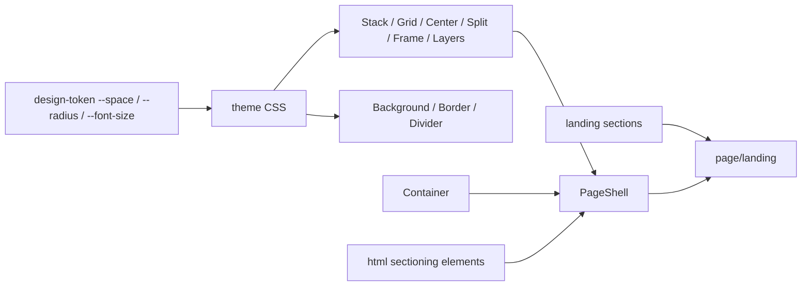

# stylist-svelte-layout

Source module extracted from stylist-svelte (afb6258628fba28b6a9bfec6b959f1ea9dd3e4ea).

Domains: `layout`.

Part of the shared stylist-svelte package. Development, indexing and sandbox integration are managed by the umbrella repository.

## HTML consolidation

All thirty component families were compared with their HTML equivalents
(`html/component/*`: HtmlDiv, HtmlSection, HtmlHr, HtmlMain, HtmlHeader, HtmlFooter…)
and with components of other domains. Layout keeps only what arranges blocks on a page:
layout primitives, surfaces, page templates. Behaviours and widgets moved to their domains.

| Original family                | Decision | Reason / replacement                                                                                                     |
| ------------------------------ | -------- | ------------------------------------------------------------------------------------------------------------------------ |
| AspectRatio                    | Keep     | Frame with `aspect-ratio` and clipped overflow; no HTML equivalent.                                                      |
| Background                     | Keep     | Surface: tone variants, colour, image, gradient, opacity.                                                                |
| GradientBackground             | Merged   | Into Background: `background="gradient" gradient="linear-gradient(…)" animated speed={15}`.                              |
| Border                         | Keep     | Border surface; its state composes ButtonComposed.                                                                       |
| Container                      | Keep     | Page width plus responsive side gutters (`--space-4/6/8`).                                                               |
| WidgetContainer                | Removed  | Dashboard panel (title, collapse, maximize), not layout and had no consumers. Compose Container + Divider or use a card. |
| Divider                        | Keep     | Labelled rule (label, align, dashed); without a label it renders a native `<hr>`.                                        |
| Separator                      | Merged   | Into Divider: `<Divider orientation="vertical" decorative />`. A plain rule without props is HtmlHr with HTML skin.      |
| Grid (SVG pattern)             | Moved    | Canvas background, not layout: `workspace/component/atom/grid-pattern` (GridPattern, RecipeGridPattern).                 |
| GridLayout                     | Removed  | Items array with `{@html}` and `role="grid"` (an interactive widget role on a static grid). Use Grid with children.      |
| Grid (molecule)                | Keep     | CSS grid: cols, responsive columns, gap, alignment.                                                                      |
| HorizontalLayout               | Merged   | Into Stack: `<Stack direction="row" wrap gap="4">`.                                                                      |
| VerticalLayout                 | Merged   | Into Stack: `<Stack gap="4">` (column by default); `fillHeight` → `fill`.                                                |
| Spacer                         | Removed  | Space between blocks is the `gap` of Stack or Grid.                                                                      |
| CenteredLayout                 | Keep     | Centre on one or both axes with an optional max width.                                                                   |
| SplitLayout                    | Keep     | Primary/secondary panes, sizes, responsive collapse (sidebar pattern).                                                   |
| OverlayLayout                  | Keep     | Layers over a base with alignment and pointer-event control.                                                             |
| ContainerQuery                 | Keep     | `container-type`/`container-name` wrapper; no HTML equivalent.                                                           |
| StickyLayout                   | Moved    | Template `component/template/page-shell` (PageShell): header/main/footer, `sticky`, `fillHeight`, `containerSize`.       |
| Clickable                      | Removed  | `div` with mouse handlers, no role or keyboard. Use HtmlButton/Button. State moved to `button/function/state/clickable`. |
| Focusable                      | Removed  | Focus ring classes only. State moved to `button/function/state/focusable`; use `:focus-visible` in CSS.                  |
| Hoverable                      | Removed  | Hover styling is CSS `:hover`.                                                                                           |
| Draggable                      | Merged   | Into DragAndDrop; its custom drag image is `dragPreview`, `showHandle` → `showDragHandle`.                               |
| DragAndDrop                    | Moved    | Behaviour of lists: `list/component/atom/drag-and-drop` (RecipeDragAndDrop, SlotDragAndDrop in `list/interface`).        |
| Popover                        | Moved    | Overlay dialog: `dialog/component/molecule/popover` (RecipePopover in `dialog/interface/recipe/popover`).                |
| AnimatedExpandableTableRow     | Removed  | Table row, no consumers. Use `table/component/molecule/row-expandable`.                                                  |
| SortableGrid                   | Removed  | Sorting is list behaviour, no consumers. Use `list/component/organism/sortable-list` or DragAndDrop.                     |
| NodeDot                        | Removed  | Decorative graph dot with no consumers; graph nodes live in `graph`.                                                     |
| NumberedStep, NumberedStepGrid | Merged   | Into StepList: `steps` takes strings or `{ title, text }`, `columns` makes a grid; with a heading use StepsSection.      |
| Stack (new)                    | Added    | Column of blocks or wrapping row (cluster); `gap` is a `--space-*` step, `as` renders `ul`/`section`/….                  |

Consumer scan: `stylist-svelte/modules/**` (`*.svelte`, `*.ts`) and the `src` of every
workspace application (lankatour.ru, sakartvelotea.com apps, myspanish.space, pavarenkin.online,
pbmtherapy, stylist-svelte.online, vibe-manager, weoracle.online, yogamaya.ru,
vibe-code-inspector, stylist-svelte-tools). Applications import layout only through the
generated root entrypoints. Migrated consumers: architecture/workspace (Separator → Divider,
Grid → GridPattern), prototype/presentation (GridPattern), interaction/button ButtonComposed
(clickable/focusable state), sandbox DomainFilePreview story (PageShell story). Sandbox
fixtures that only mention old paths as sample strings were left as data. Generated
root/domain exports and the sandbox manifest need human regeneration. Unseen consumers of a
published package cannot be established by this scan.

This is a public API removal. Migration:

```svelte
<script lang="ts">
	import Stack from '$stylist/layout/component/atom/stack/index.svelte';
	import Divider from '$stylist/layout/component/atom/divider/index.svelte';
	import Background from '$stylist/layout/component/atom/background/index.svelte';
	import PageShell from '$stylist/layout/component/template/page-shell/index.svelte';
	import GridPattern from '$stylist/workspace/component/atom/grid-pattern/index.svelte';
	import DragAndDrop from '$stylist/list/component/atom/drag-and-drop/index.svelte';
	import Popover from '$stylist/dialog/component/molecule/popover/index.svelte';
	import { createClickableState } from '$stylist/button/function/state/clickable';
</script>

<PageShell sticky containerSize="lg">
	{#snippet header()}<Stack direction="row" justify="between">…</Stack>{/snippet}
	<Stack gap="6">
		<Divider label="Section" align="left" />
		<Background background="gradient" gradient="linear-gradient(135deg, #667eea, #764ba2)" animated>
			…
		</Background>
	</Stack>
</PageShell>
```

The `$stylist` imports above are workspace aliases; package consumers use the
corresponding `stylist-svelte/<domain>/...` subpaths.

## Landing blocks (from `customer/landing`)

Dmitrii decided that the landing building blocks are public design-system API, so the private
`customer/landing` domain moved into layout. Every text, link and image is a prop; site palettes
plug in through the `--<block>-*` custom properties.

| Original (`$stylist/landing/…`)   | Now (`$stylist/layout/…`)                   | Change                                                                                   |
| --------------------------------- | ------------------------------------------- | ---------------------------------------------------------------------------------------- |
| molecule/section-heading          | molecule/section-heading                    | Optional `level` (2/3).                                                                  |
| molecule/step-list                | molecule/step-list                          | Steps may be `{ title, text }`; `columns` grid (absorbs NumberedStep*).                  |
| molecule/name-hero-media-items    | molecule/feature-items                      | Renamed; optional `id`; `--name-hero-media-items-name` → `--feature-items-value`.        |
| molecule/nav-bar                  | molecule/nav-bar                            | `sectionLinks` → `links`; sign-in props → `actions` snippet; `menuLabel`, `themeToggle`. |
| molecule/hero-media-section       | organism/hero-section                       | Merged with the old hero: heading, media and lead; navigation left the hero.             |
| organism/hero-section             | template/landing-template                   | Navigation and mobile drawer now belong to the page frame.                               |
| organism/mobile-navigation-drawer | organism/site-navigation-drawer             | `closeLabel` prop; theme colours by default instead of a hard-coded palette.             |
| organism/definition-section       | organism/definition-section                 | Unchanged API.                                                                           |
| organism/workflow-section         | organism/steps-section + comparison-section | Split: steps with optional media; comparison table with `highlight`.                     |
| organism/cases-section            | organism/cards-section                      | `CaseItem` → `LandingCard` (kicker/result optional); `wideCount`.                        |
| organism/result-section           | organism/result-section                     | Optional `id`.                                                                           |
| —                                 | template/landing-template                   | PageShell + NavBar + SiteNavigationDrawer; `stickyNav`, `footer`.                        |
| —                                 | page/landing                                | Renders `sections: LandingSection[]` inside LandingTemplate.                             |

`LandingSection` (`type/object/landing-section`) is a union discriminated by `kind`:
`hero | features | definition | steps | comparison | cards | result | custom`. Each variant
carries the props of its block; `custom` takes `render: Snippet` (plus optional `id`/`class`) for a
site's private block. `LandingNav` describes the header and drawer.

```svelte
<script lang="ts">
	import Landing from '$stylist/layout/component/page/landing/index.svelte';
	import type { LandingSection } from '$stylist/layout/type/object/landing-section';

	const sections: LandingSection[] = [
		{ kind: 'hero', title: 'Title', lead: 'Lead', imageSrc: '/hero.png', imageAlt: '' },
		{
			kind: 'steps',
			id: 'how',
			ariaLabel: 'How it works',
			title: 'Three steps',
			steps: ['A', 'B', 'C']
		},
		{ kind: 'custom', id: 'form', render: form }
	];
</script>

{#snippet form()}…{/snippet}

<Landing nav={{ ariaLabel: 'Main', links: [{ href: '#how', label: 'How it works' }] }} {sections} />
```

The only consumer, `wbd/component/template/wbd-landing-page` (weoracle.online), now renders
`page/landing`; its props are unchanged, private WBD blocks (public polls, application form,
intro) are `custom` sections. `--landing-max-width` sets the content width (default 1180px).

## Remaining entities and data flow

- Primitives: Stack, Grid, CenteredLayout (center), SplitLayout (sidebar), AspectRatio
  (frame), OverlayLayout (layers), ContainerQuery, Container, Divider.
- Surfaces: Background (tones, image, static or animated gradient), Border.
- Templates: PageShell (header/main/footer, `sticky`, `stickyFooter`), LandingTemplate.
- Landing blocks: SectionHeading, StepList, FeatureItems, NavBar, HeroSection, DefinitionSection,
  StepsSection, ComparisonSection, CardsSection, ResultSection, SiteNavigationDrawer.
- Page: Landing (typed `LandingSection[]`).
- Fluid heading sizes (`clamp(…cqw…)`) stay literal: the scale has fixed steps only.
- Spacing in component CSS uses the theme scale `--space-*`, `--font-size-*`, `--radius-*`;
  no `--spacing-*`, `--layout-spacing-*` or `--border-radius-*`. Grid and SplitLayout still
  accept `sm|md|lg|xl` gaps mapped to `--space-2/4/6/8`; Stack takes scale steps directly.
- `interface/behavior/{clickable,focusable,draggable,…}` stay here: many recipes across
  domains compose them.
- `class/manager/gesture` normalises click contracts for `button/function/state/clickable`.


